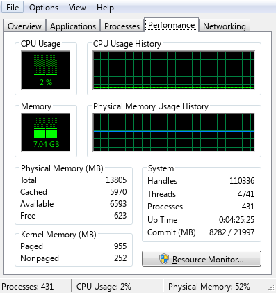

# Windows 7 Task Manager for KDE Plasma

A Windows 7 Task Manager interface for Linux, built from KDE's
`plasma-systemmonitor` and powered by KSysGuard / `ksystemstats`.

This fork recreates the compact Windows 7 layout, Aero controls, menus, dialogs,
and graphs, with an additional Overview tab. The executable and desktop ID remain
`plasma-systemmonitor` and `org.kde.plasma-systemmonitor.desktop`.



## Current baseline

| Tab | Contents |
| --- | --- |
| Overview | CPU and memory gauges, combined history, system and I/O readings, and a sortable top-process table. |
| Applications | Application tasks from systemd application groups, with a user-process fallback, task actions, and three view modes. |
| Processes | Sortable, resizable columns, CPU and memory percentages, process termination, priority, affinity, and properties dialogs. |
| Performance | Combined or up to eight per-core CPU graphs, optional kernel-time traces, memory history, and system statistics. |
| Networking | Aggregate traffic history with automatic scaling and a Windows-style adapter table. |

Overview and Processes both show **CPU %** and **Memory %** to one decimal place.
CPU is normalized against whole-system capacity. Memory is the process share of
physical RAM; the original memory-size column remains available. Headers sort
numerically, and horizontal scrolling keeps headers aligned with their columns.

The visual baseline uses 12px Segoe UI text (9pt at 96 DPI), 23px command buttons,
square tab joins, Aero scrollbars, and a three-pane status bar. The **Windows**
menu appears on **Applications**, matching the reference Task Manager's
contextual window commands. Existing custom `.page` files can appear as extra
tabs.

## Update speed

**View → Update Speed** controls the five built-in tabs and status bar through
one shared refresh clock.

| Setting | Interval |
| --- | --- |
| High | 0.5 seconds |
| Normal | 2 seconds; default at startup |
| Low | 4 seconds |
| Paused | Automatic display updates stop |

**View → Refresh Now**, or **F5**, takes one sample while leaving Paused selected.
Process values and list membership stay frozen between samples. Gauges and
status values use the same sampling cycle; visible graphs advance once per
refresh. Each sample uses the latest backend readings, whose native sampling
rate determines when new values become available.

## Build and run

Build requirements include CMake 3.16+, a C++20 compiler, Qt 6.10+, KDE Frameworks
6.24+, and KSysGuard 6.6+. Qt Quick Controls, Kirigami, and the KSysGuard sensor
and process QML modules are needed at runtime. See [CMakeLists.txt](CMakeLists.txt)
for the complete dependency list.

Stop the reference Windows 7 QEMU VM before compiling. Always build with **`-j2`**
to keep memory use within the development machine's limits.

```bash
cmake -S . -B build \
    -DCMAKE_BUILD_TYPE=RelWithDebInfo \
    -DBUILD_TESTING=ON \
    -DCMAKE_INSTALL_PREFIX="$HOME/.local/lib/win7-task-manager"
cmake --build build -j2

# Run the development build with its own QML modules.
QML_IMPORT_PATH="$PWD/build/bin" ./build/bin/plasma-systemmonitor

# Open a particular tab.
QML_IMPORT_PATH="$PWD/build/bin" ./build/bin/plasma-systemmonitor --page-name Processes
```

### Fonts and icons

The app first loads Windows 7 Segoe UI from
`~/.local/share/linux-explorer-win7/reference-fonts/`: `segoeui.ttf`,
`segoeuib.ttf`, and `segoeuii.ttf`. It also attempts to load `tahoma.ttf` there.
The fallback Segoe UI faces come from `~/.local/share/fonts/reactxp-segoe-ui/`.
These fonts are external assets and are not included in this repository.

The window icon uses the `utilities-system-monitor.png` assets under
`/usr/share/icons/Windows 7 Aero/apps/`, with the current icon theme as a fallback.
The font database must be initialized before registering the reference fonts;
loading two Segoe UI versions can replace the intended faces.

## Current local installation

The configured desktop installation uses:

| Item | Location or value |
| --- | --- |
| Install prefix | `~/.local/lib/win7-task-manager` |
| Launch command | `~/.local/bin/plasma-systemmonitor` |
| Start menu name | **Task Manager** |
| Desktop shortcut | **Ctrl+Shift+Esc** |
| Desktop ID | `org.kde.plasma-systemmonitor.desktop` |

The launch command is a wrapper that supplies the private QML import and data
paths before starting the installed executable. User launcher overrides live in
`~/.local/share/applications/` and `~/.local/share/kglobalaccel/`. They preserve the
desktop ID so existing menu entries and pins resolve to the local app.

After building a change, close the running local app, then update this existing
installation with:

```bash
cmake --install build

# Retain this machine's Task Manager name, shortcut, and absolute launch command.
cp "$HOME/.local/share/applications/org.kde.plasma-systemmonitor.desktop" \
   "$HOME/.local/lib/win7-task-manager/share/applications/org.kde.plasma-systemmonitor.desktop"
cp "$HOME/.local/share/kglobalaccel/org.kde.plasma-systemmonitor.desktop" \
   "$HOME/.local/lib/win7-task-manager/share/kglobalaccel/org.kde.plasma-systemmonitor.desktop"
kbuildsycoca6 --noincremental
```

Launch `plasma-systemmonitor` or use Ctrl+Shift+Esc afterward. Rebuilding alone updates only the development binary. The
wrapper and launcher overrides are user configuration; a fresh CMake installation
needs them configured separately. The repository's desktop template still has
the upstream System Monitor name and Meta+Esc default.

## Verification

```bash
QT_QPA_PLATFORM=offscreen ctest --test-dir build --output-on-failure

# Render the built-in views without opening or focusing a desktop window.
QT_QPA_PLATFORM=offscreen \
    WIN7_SCREENSHOT_DIR=/tmp/win7-task-manager-check \
    QML_IMPORT_PATH="$PWD/build/bin" \
    ./build/bin/plasma-systemmonitor
```

The tests cover application metadata, page management, refresh timing,
pause/manual refresh/resume, and frozen process values and membership. Qt's page
tests use `~/.qttest`; they need access to that test directory.

Screenshot capture runs sequentially and exits when complete. It saves all five
tabs, sorted/scrolled tables, menus, context menus, dialogs, and paired paused
captures. Main client images are 397×421; dialogs use their own dimensions.
The following check verifies that every built-in tab stayed frozen and that a
manual refresh changed Overview:

```python
from pathlib import Path

shots = Path("/tmp/win7-task-manager-check")
for tab in ("overview", "applications", "processes", "performance", "networking"):
    assert (shots / f"our_{tab}_paused.png").read_bytes() == (
        shots / f"our_{tab}_paused_again.png"
    ).read_bytes(), tab
assert (shots / "our_overview_paused.png").read_bytes() != (
    shots / "our_overview_refreshed.png"
).read_bytes()
```

## Implementation status

The interface uses Linux process and sensor data with Windows-style labels.
Several reference UI elements remain preliminary:

- Performance's Handles, Threads, and Windows kernel-memory fields are estimates.
- Networking uses aggregate traffic, a nominal 100 Mbps link, a fixed Connected
  label, and a `wlp2s0` lookup for the optional wireless network name.
- Target-window activation, minimize/maximize, tiling, and cascade behavior is
  incomplete. Debug, UAC virtualization, and dump creation are disabled.
- End Process Tree currently force-kills the selected PID. Resource Monitor
  opens Overview.

## Project notes

[AGENTS.md](AGENTS.md) contains the component map, reference-image locations,
rendering constraints, refresh architecture, and deployment notes.
[CLAUDE.md](CLAUDE.md) mirrors that guide.

This fork builds on [KDE Plasma System Monitor](https://invent.kde.org/plasma/plasma-systemmonitor).
See [LICENSES](LICENSES) and individual source-file SPDX notices for licensing.

<!--
SPDX-FileCopyrightText: 2020 Arjen Hiemstra <ahiemstra@heimr.nl>
SPDX-License-Identifier: BSD-3-Clause
-->
